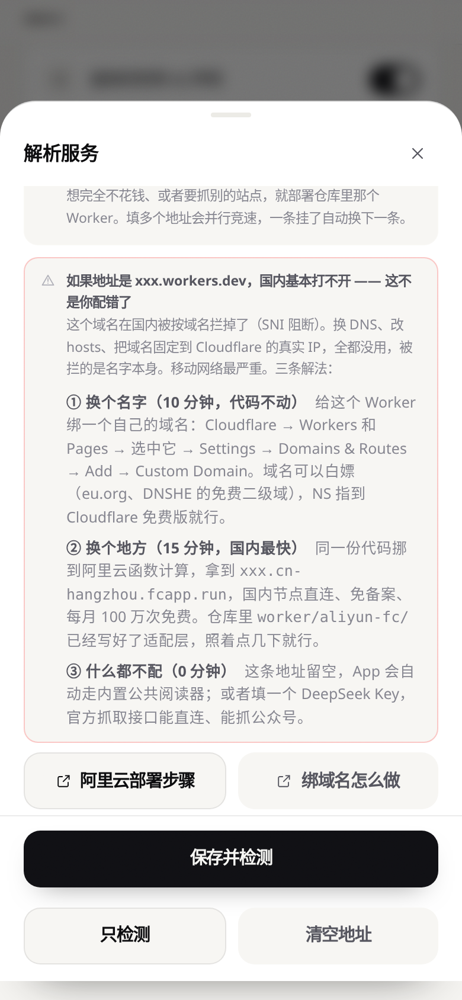
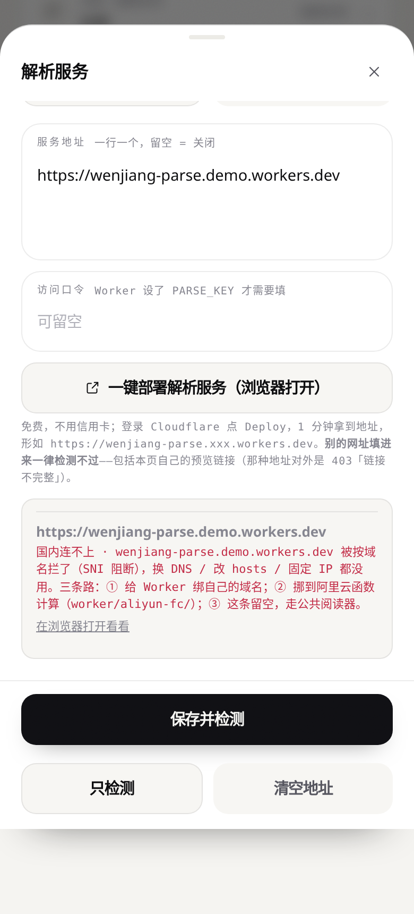

# Cloudflare 解析链接在国内连不上，怎么办

> 版本 v2.19.0 · 2026-11-22 · 文匠 AI

## 一句话结论

不是你的配置错了。`*.workers.dev` 这个域名在国内被**按名字**拦掉了，换 DNS、改 hosts、把域名固定到 Cloudflare 的真实 IP，全都没用。只能换名字，或者换地方。

## 为什么连不上

国内的拦截不是封 IP，是在 TLS 握手时看 SNI 里带的域名。`workers.dev`、`pages.dev`、`vercel.app`、`netlify.app` 这一类共享域名在黑名单里：

1. 先污染 DNS，把这个域名解析到假 IP（有的直接给 Facebook 的地址）；
2. 就算你手动改 hosts、或者用 DoH 拿到 Cloudflare 的真实 IP，TCP 能连上，但 TLS ClientHello 里 SNI 写的是 `workers.dev`，会被立刻 RST。

所以「换 8.8.8.8」「改 hosts」「固定 IP」「开热点」这一套组合拳，对它完全无效——被拦的是名字本身。

顺带一个坏消息：Cloudflare 免费版在中国大陆没有节点（大陆节点只对企业版开放）。就算域名通了，请求也是落到香港、东京、新加坡，实测电信 80–150ms、联通 120–200ms、移动 200–400ms 起，晚高峰还丢包。移动网络是这三家里最差的，而手机用户大多在移动网络。

## 三条路，按改动量排

| | 改什么 | 花多久 | 花钱 | 国内速度 | 适合谁 |
|---|---|---|---|---|---|
| ① 绑自己的域名 | 代码一行不改，只加一条 Custom Domain | 10 分钟（域名 NS 生效可能几小时） | 域名可以白嫖 | 电信 80–150ms / 联通 120–200ms / 移动 200–400ms | 已经有域名的人 |
| ② 挪到阿里云函数计算 | 代码不动，换部署位置 | 15–20 分钟 | 每月 100 万次免费 | 国内节点直连，最稳 | 想一次弄好、要发给别人用 |
| ③ 什么都不配 | App 里地址留空 | 0 分钟 | 免费或约 5 元/1000 次 | 看公共通道脸色 | 只想赶紧写稿 |



## 路线一：给现有 Worker 绑自己的域名

Worker 本身没坏，坏的是它默认那个 `xxx.workers.dev` 名字。给它挂一个干净的域名就行。

1. 准备一个域名，NS 托管到 Cloudflare（免费版就行）。不想买的话：
   - `eu.org`：免费，审核要几天到几周，老牌稳定；
   - DNSHE 之类的免费二级域（`.us.ci`、`.de5.net`）：几分钟能用，但注册商寿命不可控。
2. Cloudflare 控制台 → **Workers 和 Pages** → 选中你那个 Worker。
3. **Settings** → **Domains & Routes** → **Add** → **Custom Domain**。
4. 填 `parse.你的域名`，点 Add。Cloudflare 会自动加 DNS 记录、签证书。
5. 地址就从 `xxx.workers.dev` 变成 `https://parse.你的域名`。到 App 的「我的 → 解析服务」把地址换掉，点「保存并检测」。

一个提醒：微信内置浏览器对**未备案的境外域名**更严格，容易白屏或者折叠。如果这个 App 要发给别人用，路线二比路线一稳。

## 路线二：挪到阿里云函数计算（代码已经写好了）

仓库里新增了 `worker/aliyun-fc/`，把同一份 `worker/index.js` 原样跑在阿里云 FC 3.0 的 Web 函数上，拿到 `https://xxx.cn-hangzhou.fcapp.run`：国内节点直连、免备案、每月 100 万次调用 + 40 万 CU-秒免费、不需要信用卡。

详细步骤见 [`worker/aliyun-fc/README.md`](../worker/aliyun-fc/README.md)，摘要：

1. 打开 <https://fc.console.aliyun.com/>，开通函数计算（按量付费），完成实名认证。
2. 创建函数 → 选 **Web 函数** → Node.js 20 → 启动命令 `node aliyun-fc/index.mjs` → 监听端口 `9000`。
3. 本地打包上传：`cd worker && zip -r ../wenjiang-parse.zip index.js package.json aliyun-fc`。不用装依赖。
4. 创建完拿到公网地址，把 `/` 后面的路径去掉，填进 App 的「服务地址」。

两个已知限制（不影响本服务）：

- 阿里云会给所有 `fcapp.run` 响应强加 `content-disposition: attachment`，浏览器直接打开会变成下载。App 用 `fetch()` 读 body，不受影响。
- 任何 3xx 跳转会被网关改成 400。本服务不做重定向，所以没影响。

## 路线三：什么都不配

App 里地址留空时，会自动走内置的公共阅读器链（r.jina.ai、allorigins、codetabs 等）。这条路免费、不用部署，但会限速、个别站点抓不到。

另外还有两个更稳的选择：

- **DeepSeek 官方抓取接口**：浏览器能直连，公众号也能抓，正文是干净的 Markdown，约 5 元/1000 次，抓失败不计费。Key 只存在手机本地。
- **打开原文 → 复制 → 切回来自动读回**：这条永远可用，不依赖任何服务。

## 这轮改了什么

**1. 检测时直接判定「被墙」，不再笼统说「连不上」。** 以前填一个 `workers.dev` 地址，界面只会回「连不上 · 无响应」；现在会直接说「被按域名拦了（SNI 阻断），换 DNS / 改 hosts / 固定 IP 都没用」，后面跟三条解法。实测 4.2 秒内出结果，不给它 9 秒白等。



**2. 解析失败时，把原因写在错误详情第一行。** 配置里躺着被墙域名时，报错详情不再是「这个链接没取到正文」，而是先说明「配置的 xxx.workers.dev 在国内连不上」，再给三条路。

**3. 启动体检会把被墙地址自动停用，并说明原因。** 提示语从「已移除 N 条打不开的解析地址（连不上）」改成「已停用 N 条国内打不开的解析地址（xxx.workers.dev 被墙）」。

**4. 面板里新增一张红框卡片 + 两个直达按钮。** 「阿里云部署步骤」「绑域名怎么做」，点开就是对应的 GitHub 文档。

**5. 新增 `worker/aliyun-fc/` 部署包。** 一个 80 行的适配层（Node `http` → Web `Request`/`Response`），把 CF 版的所有接口原样搬过去。

## 实测

阿里云 FC 适配层本地跑通（`node worker/aliyun-fc/index.mjs`，监听 9000）：

```
$ curl http://127.0.0.1:9000/api/health
{"ok":true,"version":"3.6.0","runtime":"worker"}

$ curl "http://127.0.0.1:9000/api/parse?url=https://sspai.com/post/119191"
{"ok":true,"title":"给 Apple 的 2026 年打分，请你一起参与 - 少数派",
 "chars":1124,"images":[5 张],"video":false}

$ curl "http://127.0.0.1:9000/api/meta?url=https://sspai.com/post/119191"
{"ok":true,"title":"...","desc":"2026年以来，Apple在硬件领域明显加快了产品线的拓展…"}
```

界面回归（320 / 390 / 430 三档宽度）：

| 视口 | 文档宽度 | 横向溢出 | JS 报错 |
|---|---|---|---|
| 320 | 320 | 0 | 0 |
| 390 | 390 | 0 | 0 |
| 430 | 430 | 0 | 0 |

## 老实说，还差什么

- **阿里云那几步我没法替你点。** 实名认证、创建函数、上传 zip，必须你本人操作。代码和步骤都备好了。
- **路线一在移动网络下仍然会慢。** 绑域名只解决「打不开」，解决不了「跨境链路慢」。要快还是得路线二。
- **公共阅读器会限速。** 路线三适合偶尔用，天天用会撞到 429。
